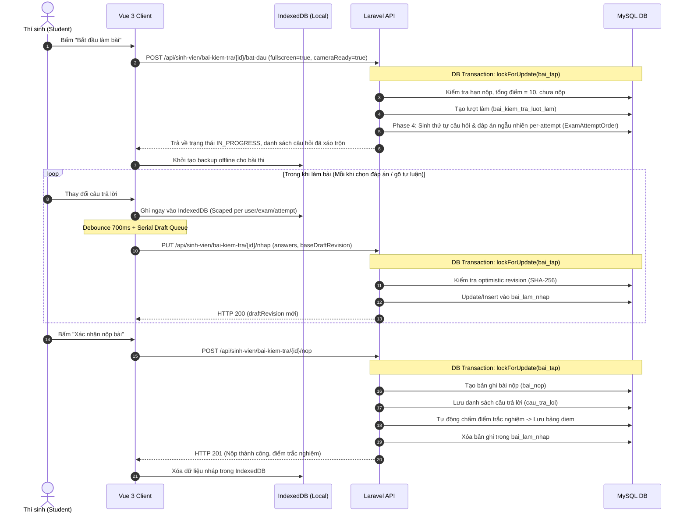
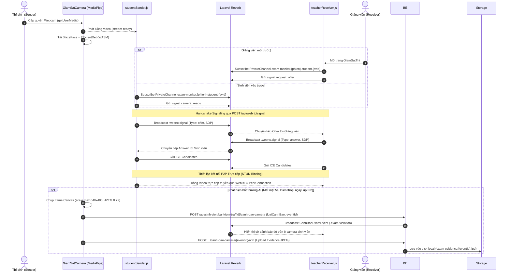

# SMART CLASSROOM MONITOR — TOÀN DIỆN BÁO CÁO KIỂM TOÁN VÀ ĐÁNH GIÁ KỸ THUẬT (FULL PROJECT AUDIT & TECHNICAL REVIEW)

**Dự án:** Smart Classroom Monitor  
**Đường dẫn:** `F:\Smart Classroom Monitor`  
**Vai trò thẩm định:** Senior Software Architect, Senior Full-stack Developer, QA Lead, Database Architect, Security Engineer, WebRTC Specialist  
**Ngày thực hiện kiểm toán:** 19/11/2026  
**Công nghệ nền tảng:** Vue 3 (Vite 6, Pinia/Reactivity), PHP 8.2+ (Laravel 12), MariaDB/MySQL, Laravel Sanctum, Laravel Reverb, WebRTC P2P, MediaPipe Tasks-Vision (BlazeFace + EfficientDet Lite0).  
**Nguyên tắc thực thi:** **CHỈ ĐỌC, PHÂN TÍCH VÀ ĐÁNH GIÁ. KHÔNG THAY ĐỔI MÃ NGUỒN, SCHEMA HOẶC DỮ LIỆU.**

---

## MỤC LỤC BÁO CÁO

1. [Tóm tắt điều hành (Executive Summary)](#1-tóm-tắt-điều-hành-executive-summary)
2. [Tổng quan kiến trúc hệ thống (System Architecture Overview)](#2-tổng-quan-kiến-trúc-hệ-thống-system-architecture-overview)
3. [Sơ đồ luồng hoạt động hệ thống (System Workflow Diagrams)](#3-sơ-đồ-luồng-hoạt-động-hệ-thống-system-workflow-diagrams)
4. [Đánh giá chi tiết từng module chức năng (Detailed Module Review)](#4-đánh-giá-chi-tiết-từng-module-chức-năng-detailed-module-review)
5. [Danh sách lỗi & phân loại theo mức độ nghiêm trọng (Defect Findings & Classification)](#5-danh-sách-lỗi--phân-loại-theo-mức-độ-nghiêm-trọng-defect-findings--classification)
6. [Đánh giá Database & Ma trận quan hệ định danh (Database Schema & Identity Mapping Audit)](#6-đánh-giá-database--ma-trận-quan-hệ-định-danh-database-schema--identity-mapping-audit)
7. [Đánh giá an toàn & bảo mật (Security Audit)](#7-đánh-giá-an-toàn--bảo-mật-security-audit)
8. [Đánh giá WebRTC, Camera AI và Realtime (WebRTC, AI & Realtime Deep-Dive)](#8-đánh-giá-webrtc-camera-ai-và-realtime-webrtc-ai--realtime-deep-dive)
9. [Đánh giá hiệu năng & Khả năng chịu tải đồng thời (Performance & Scalability Audit)](#9-đánh-giá-hiệu-năng--khả-năng-chịu-tải-đồng-thời-performance--scalability-audit)
10. [Kết quả kiểm thử & Phân tích chuyên sâu 5 lỗi Tests (Testing & Test Suite Failure Analysis)](#10-kết-quả-kiểm-thử--phân-tích-chuyên-sâu-5-lỗi-tests-testing--test-suite-failure-analysis)
11. [Bảng điểm chất lượng toàn diện dự án (Project Scorecard)](#11-bảng-điểm-chất-lượng-toàn-diện-dự-án-project-scorecard)
12. [Lộ trình cải tiến & Tối ưu hóa (Improvement Roadmap: P0 → P3)](#12-lộ-trình-cải-tiến--tối-ưu-hóa-improvement-roadmap-p0--p3)
13. [Kết luận về mức độ sẵn sàng triển khai thực tế (Production Readiness Verdict)](#13-kết-luận-về-mức-độ-sẵn-sàng-triển-khai-thực-tế-production-readiness-verdict)

---

## 1. TÓM TẮT ĐIỀU HÀNH (EXECUTIVE SUMMARY)

Dự án **Smart Classroom Monitor** là một hệ thống web tích hợp quản lý lớp học trực tuyến, tổ chức thi trắc nghiệm kết hợp tự luận và giám sát thí sinh theo thời gian thực thông qua Camera AI và WebRTC. 

Trải qua nhiều chu kỳ nâng cấp (từ các bản sửa Critical Phase 1, High Phase 2, module kiểm tra hai hình thức `ONLINE_CAMERA_REQUIRED` / `LAB_NO_CAMERA`, cơ chế xáo trộn đề Phase 4 và gỡ bỏ hoàn toàn Ngân hàng câu hỏi), hệ thống đã hình thành một khung nghiệp vụ phong phú và giải quyết được nhiều bài toán phức tạp:
- **Cơ chế chống gian lận đa lớp:** Fullscreen enforcement, chặn phím tắt, nhận diện rời tab, chống sao chép/dán, phát hiện hành vi qua camera (không có mặt, nhiều mặt, phát hiện điện thoại) kết hợp lưu vết ảnh bằng chứng (evidence snapshot) vào storage riêng tư có mã hóa đường dẫn và thời hạn lưu trữ.
- **Độ tin cậy làm bài thi:** Cơ chế lưu nháp tuần tự (serial queue) với optimistic revision token (SHA-256) tránh ghi đè chéo, sao lưu cục bộ bằng IndexedDB có TTL 24h và scope chặt chẽ theo `userId_examId_attemptId`.
- **Hệ thống báo cáo thi 6 sheet:** Xuất Excel đa sheet (Tổng quan, Sinh viên, Kết quả, Cảnh báo, Rà soát, Thống kê) với thuật toán phòng vệ tấn công chèn công thức độc hại (Excel Formula Injection).

Tuy nhiên, cuộc kiểm toán kỹ thuật chuyên sâu này xác định **những điểm nghẽn nghiêm trọng (Architectural Bottlenecks) và rủi ro lớn** ngăn cản hệ thống triển khai an toàn trên môi trường thi thật:
1. **Điểm nghẽn khóa hàng toàn cục (Database Lock Contention):** Tất cả các thao tác của sinh viên trong lúc thi (bắt đầu thi, lưu nháp mỗi vài giây, nộp bài, báo rời tab, gửi cảnh báo camera) đều kích hoạt lệnh `lockForUpdate()` trên **cùng một hàng `bai_tap`**. Khi một lớp 30–50 sinh viên cùng thao tác, toàn bộ các luồng ghi bị tuần tự hóa thành hàng đợi đơn lẻ, chắc chắn dẫn đến lỗi quá thời gian chờ khóa (`Lock wait timeout exceeded`) và đơ hệ thống.
2. **WebRTC P2P Mesh không có TURN Server:** Cấu hình ICE chỉ khai báo các STUN server công cộng của Google (`stun.l.google.com`), hoàn toàn không có máy chủ Relay (TURN - Coturn/Xirsys). Trên thực tế, 15% – 30% sinh viên sử dụng mạng 4G di động hoặc Wi-Fi gia đình qua NAT đối xứng (Symmetric NAT) sẽ không thể thiết lập kết nối P2P tới Giảng viên.
3. **Quá tải tài nguyên máy Giảng viên theo hàm O(N):** Mô hình WebRTC hiện tại là Client-to-Client Mesh. Máy tính của Giảng viên phải giải mã đồng thời 30–50 luồng video camera, vượt quá số lượng bộ giải mã phần cứng (Hardware Decoders) của trình duyệt và card đồ họa thông thường, gây tràn RAM và sập tab trình duyệt.
4. **Lỗ hổng Unrestricted File Upload tại Module Nộp bài thực hành:** Endpoint `POST /api/sinh-vien/bai-tap/{id}/nop-bai` chỉ kiểm tra dung lượng `<= 10MB` mà không hề giới hạn đuôi file hay MIME type, đồng thời lưu file trực tiếp vào thư mục `public` storage.
5. **MediaPipe chạy trên Main UI Thread:** Việc suy luận đồng thời 2 mô hình (BlazeFace Short Range và EfficientDet Lite0) trên luồng giao diện chính mỗi 300–500ms gây giật lag (frame drops) và tiêu tốn 40% – 80% CPU máy thí sinh.

**Đánh giá mức độ sẵn sàng triển khai (Production Readiness):** **CHƯA ĐẠT (NOT PRODUCTION-READY)**. Dự án chỉ có thể triển khai thử nghiệm nội bộ quy mô nhỏ (< 10 sinh viên, mạng LAN chung, không qua NAT đối xứng). Cần hoàn thiện lộ trình khắc phục P0 và P1 trước khi tổ chức kỳ thi chính thức.

---

## 2. TỔNG QUAN KIẾN TRÚC HỆ THỐNG (SYSTEM ARCHITECTURE OVERVIEW)

Hệ thống được tổ chức theo kiến trúc phân tách Client-Server (Decoupled Single Page Application):

```
+-------------------------------------------------------------------------------------------------+
|                                     CLIENT LAYER (Vue 3 + Vite)                                 |
|                                                                                                 |
|   [Layout: Admin]                  [Layout: Lecturer]                  [Layout: Student]        |
|   - Quản lý người dùng,            - Quản lý lớp, bài tập,             - Làm bài thi (Fullscreen)|
|     vai trò, phân quyền,             lịch thi, chấm tự luận,           - IndexedDB Draft Backup |
|     lớp học                          báo cáo thi Excel 6-sheet         - Anti-cheat Guards      |
|                                    - Giám sát WebRTC Grid              - MediaPipe Vision AI    |
+-------------------------------------------------------------------------------------------------+
          |                                  | WebSocket (Echo/Pusher)           ^
          | REST API (Axios + Sanctum Bearer)| (port 8080)                       | MediaStream P2P
          v                                  v                                   v (Direct Video)
+-------------------------------------------------------------------------------------------------+
|                                 APPLICATION BACKEND (Laravel 12)                                |
|                                                                                                 |
|   - Routing & Middleware: Sanctum, QuanTriVien, GiangVien, Throttling                          |
|   - Business Services: ExamReportService, ExamReportExportService, ExamAttemptOrder, ExamMode   |
|   - Controllers: 25+ Controllers (REST, Evidence Streamer, WebRTC Signaling)                    |
|   - Event Broadcasting: CanhBaoExamEvent, ExamProtectionAlertEvent, WebRtcSignalEvent           |
|   - Storage: Local Disk (exam-evidence private) & Public Disk (bai-nop, avatars)               |
+-------------------------------------------------------------------------------------------------+
          |                                  ^                                   |
          | PDO / MySQL Eloquent Queries     | Broadcast Events                  | Auth & Signals
          v                                  | (Reverb Push)                     v
+-------------------------------+  +-----------------------------------+  +-----------------------+
|        DATABASE (MySQL)       |  |       LARAVEL REVERB SERVER       |  |  STUN SERVERS (Google)|
| - 38 Migrations, 25+ Tables   |  | - Port 8080 (WS/WSS)              |  | (stun.l.google.com)   |
| - InnoDB Tables with Trx Locks|  | - Private Channels:               |  | * THIẾU TURN SERVER!  |
| - Attempt Shuffle Orders      |  |   exam-monitor.{phien}.student.*  |  +-----------------------+
+-------------------------------+  |   exam-session.{phien}            |
                                   +-----------------------------------+
```

### Các thành phần kiến trúc chính:
1. **Frontend (Vue 3 + Vite):** Sử dụng Composition API (`<script setup>`), Vue Router 4, Axios instance tích hợp Interceptor đính kèm Bearer Token. Quản lý trạng thái phân tán dựa trên Vue Reactivity (`ref`, `reactive`), không phụ thuộc Pinia tập trung.
2. **Backend (Laravel 12):** Kiến trúc RESTful kết hợp Action Services. Xác thực Token thông qua Laravel Sanctum (`personal_access_tokens`). Quản lý phân quyền dựa trên Middleware và RBAC động (các bảng `vai_tro`, `chuc_nang`, `phan_quyen`).
3. **Real-time Layer (Laravel Reverb):** Máy chủ WebSocket thế hệ mới của Laravel chạy trên giao thức Pusher, chịu trách nhiệm truyền tải tín hiệu Signaling WebRTC (`offer`, `answer`, `candidate`, `camera_ready`, `request_offer`) và phát tán cảnh báo gian lận thi cử.
4. **Computer Vision Layer (MediaPipe Tasks-Vision):** Chạy trực tiếp tại trình duyệt sinh viên (In-browser Edge AI), tải 2 mô hình `.tflite` từ Google Cloud CDN để nhận diện khuôn mặt và vật thể điện thoại.
5. **Persistence Layer (MySQL/MariaDB):** Cơ sở dữ liệu quan hệ InnoDB hỗ trợ ACID Transactions, Foreign Key Constraints và Pessimistic Locking (`lockForUpdate`).

---

## 3. SƠ ĐỒ LUỒNG HOẠT ĐỘNG HỆ THỐNG (SYSTEM WORKFLOW DIAGRAMS)

### 3.1. Luồng Bắt đầu thi, Lưu nháp và Nộp bài (Exam Lifecycle)



### 3.2. Luồng Báo hiệu WebRTC và Giám sát Camera AI



---

## 4. ĐÁNH GIÁ CHI TIẾT TỪNG MODULE CHỨC NĂNG (DETAILED MODULE REVIEW)

### 4.1. Authentication & Phân quyền (Auth & RBAC)
- **Cơ chế xác thực:** Sử dụng Bearer Token của Laravel Sanctum (`personal_access_tokens`). Token được lưu trong `sessionStorage` (hoặc `localStorage`). Hỗ trợ cấu hình hết hạn (`expires_at`), kiểm tra trạng thái hoạt động của tài khoản (`trang_thai === 'hoat_dong'`).
- **Phân quyền người dùng:** Hệ thống chia làm 3 nhóm vai trò chính:
  1. `quan_tri_vien` (Admin): Bảo vệ bởi Middleware `QuanTriVien`. Có toàn quyền CRUD người dùng, lớp học, vai trò, chức năng và bảng chi tiết phân quyền.
  2. `giang_vien` (Lecturer): Bảo vệ bởi Middleware `GiangVien`. Quản lý các lớp được phân công, tạo bài tập, cấu hình đề, kích hoạt phiên giám sát, chấm điểm và xem báo cáo.
  3. `sinh_vien` (Student): Không có middleware riêng ở cấp route group mà được kiểm tra thông qua quan hệ `sinh_vien.nguoi_dung_id` bên trong từng Controller action.
- **Lỗ hổng & Điểm yếu:**
  - Route `POST /api/dang-nhap` **hoàn toàn không có middleware Rate Limiting (Throttle)** (`be/routes/api.php:42`). Kẻ tấn công có thể thực hiện tấn công Brute-Force từ điển để bẻ khóa mật khẩu tài khoản mà không bị chặn. Đây chính là nguyên nhân gốc khiến test `DangNhapTest::test_login_is_rate_limited` bị thất bại (kỳ vọng HTTP 429 nhưng nhận HTTP 401).
  - Thiếu Middleware cấp Route cho Sinh viên: Các route sinh viên chỉ nằm trong nhóm `auth:sanctum`. Nếu một Giảng viên vô tình gọi các API này, controller mới bắt đầu kiểm tra hồ sơ sinh viên và trả về 403. Nên có một Middleware `SinhVien` riêng tương tự `GiangVien` để chặn sớm ở tầng định tuyến.

### 4.2. Quản lý lớp học & Thành viên (Classroom Management)
- **Quản lý lớp học:** Bảng `lop_hoc` liên kết với `nguoi_dung.id` thông qua cột `giang_vien_id`. Giảng viên được phân công phụ trách lớp sẽ có toàn quyền tạo bài tập và phiên giám sát cho lớp đó.
- **Thành viên lớp học:** Bảng `thanh_vien_lop` ánh xạ sinh viên vào lớp. Đã có ràng buộc duy nhất `unique(['lop_hoc_id', 'sinh_vien_id'])`.
- **Rủi ro định danh lịch sử:** Cột `thanh_vien_lop.sinh_vien_id` được tạo từ migration ban đầu (`2026_09_21_000004`) trỏ khóa ngoại tới `nguoi_dung.id` (thay vì bảng `sinh_vien.id`). Mặc dù code Backend đã được đồng bộ để sử dụng `$user->id`, việc đặt tên cột là `sinh_vien_id` nhưng mang giá trị của `nguoi_dung_id` là một "bẫy tư duy" rất nguy hiểm cho các lập trình viên mới tiếp cận dự án.

### 4.3. Quản lý bài kiểm tra & Đề thi (Exam Management)
- **Tạo và quản lý câu hỏi:** Hỗ trợ câu hỏi trắc nghiệm (nhiều lựa chọn, 1 đáp án đúng) và câu hỏi tự luận. Điểm số từng câu được lưu kiểu `decimal(5,2)`.
- **Phân bổ điểm tự động (`ExamScoreAllocator`):** Thuật toán tự động cân bằng điểm trắc nghiệm và tự luận để đảm bảo tổng điểm bài thi luôn bằng chính xác **10.00 điểm** (đổi ra cents = 1000 để tránh sai số dấu phẩy động IEEE 754).
- **Import đề thi Word / Excel / PDF:** `GiangVienNhapCauHoiController` hỗ trợ phân tích file tài liệu, xem trước (preview) và lưu vào đề thi. Validation file nghiêm ngặt (`mimes:docx,xlsx,pdf`, tối đa 10MB).
- **Cơ chế khóa chỉnh sửa:** Đã được cài đặt chặt chẽ ở cả `GiangVienCauHoiController:43-46` và `GiangVienNhapCauHoiController:844-847`. Ngay khi sinh viên đầu tiên bắt đầu bài thi (tồn tại bản ghi trong `bai_kiem_tra_luot_lam`) hoặc đã có bài nộp (`bai_nop`), toàn bộ API thêm/sửa/xóa câu hỏi và import sẽ bị khóa cứng với mã lỗi **HTTP 409 Conflict**.
- **Xáo trộn đề Phase 4:** Đề thi hỗ trợ xáo trộn thứ tự câu hỏi và thứ tự đáp án theo từng lượt làm riêng biệt (`ExamAttemptOrder.php`). Cấu hình lưu tại `bai_tap_cau_hinh_tron`.
- **Loại bỏ Ngân hàng câu hỏi:** Module Ngân hàng câu hỏi đã được gỡ bỏ hoàn toàn khỏi giao diện và API định tuyến (theo báo cáo `QUESTION_BANK_FULL_REMOVAL_REPORT.md`). Các bảng lịch sử trong DB được giữ nguyên ở trạng thái rỗng để bảo toàn tính toàn vẹn của migrations.

### 4.4. Hai hình thức kiểm tra (Dual Exam Modes)
Hệ thống triển khai 2 chế độ thi thông qua bảng `bai_tap_hinh_thuc_kiem_tra` và helper `ExamMode.php`:
1. `ONLINE_CAMERA_REQUIRED` (Trực tuyến bắt buộc camera):
   - Yêu cầu thí sinh cấp quyền camera và kết nối WebRTC trước khi được phép bấm "Bắt đầu làm bài".
   - Kích hoạt toàn bộ luồng giám sát MediaPipe (mất mặt, nhiều mặt, điện thoại) và tải ảnh bằng chứng.
   - Giảng viên quan sát lưới video trực tiếp của thí sinh trên giao diện `GiamSatThi`.
2. `LAB_NO_CAMERA` (Thi tại phòng máy không dùng camera):
   - Hoàn toàn **không kích hoạt camera**, không gọi `getUserMedia()`, không tải mô hình AI MediaPipe, không kết nối luồng video WebRTC.
   - Vẫn duy trì 100% cơ chế bảo vệ trình duyệt: ép Fullscreen, chống sao chép/cắt/dán, phát hiện rời tab bài thi (`reportTabLeave`), sao lưu IndexedDB và lưu nháp tự động.
   - Các API ghi nhận cảnh báo camera (`canh-bao-camera`) và tải ảnh bằng chứng bị vô hiệu hóa với mã lỗi **HTTP 409**, ngăn chặn việc sinh cảnh báo camera giả mạo.
- **Tương thích ngược (Backward Compatibility):** Các bài thi cũ chưa được cấu hình hình thức sẽ tự động nhận diện là `ONLINE_CAMERA_REQUIRED`, đảm bảo không làm gián đoạn các bài thi đã tạo trước đó.

### 4.5. Luồng làm bài thi (Student Exam Flow)
- **Điều kiện tham gia:** Kiểm tra sinh viên thuộc lớp, bài thi đã đến giờ mở, chưa hết hạn nộp, chưa nộp bài trước đó và không bị khóa thi do vi phạm quá số lần quy định.
- **Lưu nháp tự động (Autosave Draft):**
  - Frontend sử dụng hàng đợi tuần tự (`draftSaveQueue.js`) với cơ chế gom nhóm (coalesce): nếu người dùng gõ liên tục trong khi một request lưu nháp đang chạy, các thay đổi mới sẽ được gom lại và chỉ gửi tiếp một request duy nhất sau khi request trước hoàn tất.
  - Backend sử dụng mã băm SHA-256 (`baseDraftRevision`) để kiểm tra xung đột ghi đè lạc quan (Optimistic Concurrency Control). Nếu bản nháp trên server bị cập nhật từ phiên khác, server sẽ từ chối với HTTP 409 thay vì ghi đè mất dữ liệu.
- **Sao lưu ngoại tuyến IndexedDB (`examDraftBackup.js`):** Khi gặp sự cố mạng hoặc sập nguồn trình duyệt, bài làm của sinh viên được lưu tức thì vào IndexedDB với thời gian sống TTL 24 giờ. Cơ chế phục hồi (Restore) có xác thực ID bài thi và lần thi để tránh phục hồi nhầm bài làm cũ.
- **Rời trang an toàn:** Đăng ký sự kiện `beforeunload` của trình duyệt và hook `onBeforeRouteLeave` của Vue Router, hiển thị hộp thoại xác nhận khi thí sinh vô tình bấm Back hoặc đóng tab.

### 4.6. Camera AI & Giám sát hành vi (MediaPipe Vision Monitoring)
- **Mô hình AI sử dụng:**
  - Phát hiện khuôn mặt: `blaze_face_short_range.tflite` (độ chính xác cao, nhận diện nhanh).
  - Phát hiện điện thoại: `efficientdet_lite0_uint8.tflite` (nhận diện lớp `cell phone` / `mobile phone` với độ tin cậy `>= 0.5`).
- **Ngưỡng cảnh báo và xử lý trùng lặp:**
  - Không có khuôn mặt: Cảnh báo chu kỳ mỗi **5 giây** liên tục (`NO_FACE_WARNING_MS = 5000`).
  - Nhiều khuôn mặt: Kích hoạt khi phát hiện `>= 2` khuôn mặt liên tục trong **3 giây** (`MANY_FACES_WARNING_MS = 3000`).
  - Phát hiện điện thoại: Cảnh báo **ngay lập tức** khi phát hiện (`PHONE_WARNING_MS = 0`), sau đó yêu cầu điện thoại biến mất ít nhất 2 giây mới cho phép cảnh báo đợt tiếp theo (`PHONE_RESET_MS = 2000`).
- **Chụp ảnh bằng chứng (Evidence Snapshot):** Khi phát sinh cảnh báo, canvas được render đồng bộ từ video frame, nén ảnh JPEG với các mức chất lượng [0.72, 0.55, 0.4] để đảm bảo kích thước `<= 512 KiB`, sau đó gửi lên API lưu vào storage bảo mật.
- **Lưu ý nghiệp vụ:** Cảnh báo AI chỉ mang tính chất phát hiện ban đầu (Detection Signal), hệ thống hiển thị kèm bằng chứng ảnh để Giảng viên xem xét và xác minh thủ công, không tự ý hủy bài thi của sinh viên khi chưa có kết luận của giám thị.

### 4.7. WebRTC & Laravel Reverb
- **Cấu trúc Signaling:** Sử dụng Laravel Reverb (WebSocket) kết hợp kênh riêng tư `exam-monitor.{phienId}.student.{sinhVienId}`. Quá trình trao đổi SDP Offer, SDP Answer và ICE Candidate được định tuyến qua API Sanctum `POST /api/webrtc/signal`.
- **Khắc phục lỗi trễ hiển thị camera:** Trước đây, camera sinh viên chỉ hiển thị sau khi phát sinh cảnh báo AI do `LamBaiKiemTra/index.vue` thiếu cơ chế thăm dò phiên hoạt động nếu phiên được giảng viên bật sau. Bản sửa ngày 19/11/2026 đã bổ sung `sessionBootstrap.js` (polling mỗi 5 giây cho đến khi lấy được `phienGiamSatId`) và tách việc phát luồng video `stream-ready` ngay khi `video.play()`, không còn chờ đợi MediaPipe nạp xong mô hình.
- **Điểm yếu cốt tử:** Hệ thống hoàn toàn thiếu TURN Server và chịu tải kém khi số lượng sinh viên vượt quá 15 (sẽ phân tích chi tiết tại Phần 8).

### 4.8. Hệ thống cảnh báo & Khóa bài thi (Alerts & Exam Locking)
- **Bộ đếm vi phạm và điều kiện khóa tự động:**
  - Vi phạm phát hiện điện thoại: Tối đa **3 lần** (`MAX_PHONE_WARNINGS = 3`).
  - Vi phạm camera (mất mặt, nhiều mặt, ngắt camera): Tối đa **5 lần** (`MAX_CAMERA_WARNINGS = 5`).
  - Vi phạm rời tab bài thi: Tối đa **3 lần** (`MAX_TAB_WARNINGS = 3`).
  - Khi một trong các điều kiện trên chạm ngưỡng, trạng thái bài thi chuyển thành `biKhoa = true`. Sinh viên không thể tiếp tục lưu nháp hay chỉnh sửa đáp án mà chỉ có thể bấm nộp bài hoặc chờ Giảng viên mở khóa.
- **Tính Idempotency (Chống trùng lặp):** Tất cả sự kiện cảnh báo camera và rời tab đều bắt buộc đính kèm `eventId` (chuỗi UUID v4). Database áp dụng ràng buộc `unique(['event_id'])` trên bảng `canh_bao_camera` và kiểm tra trùng lặp trên `vi_pham_kiem_tra`. Nếu client gửi lại do mạng chập chờn, server chỉ xác nhận lại trạng thái hiện tại mà không tăng số lần vi phạm.

### 4.9. Báo cáo kỳ thi & Xuất Excel 6-Sheet (Exam Reporting)
- **Giao diện báo cáo (`BaoCaoKyThi`):** Cung cấp bộ lọc theo Lớp, Bài kiểm tra, Phiên giám sát, Khoảng thời gian và Trạng thái nộp bài. Hiển thị Dashboard thống kê tỷ lệ tham gia, phổ điểm, danh sách chi tiết và các sự kiện vi phạm cần rà soát.
- **Xuất file Excel (`ExamReportExportService`):**
  - Hỗ trợ xuất đồng thời hoặc tùy chọn 6 sheet chuyên nghiệp: **1. Tổng quan**, **2. Sinh viên**, **3. Kết quả**, **4. Cảnh báo**, **5. Rà soát**, **6. Thống kê**.
  - **Phòng chống Excel Formula Injection:** Phương thức `safeText()` kiểm tra toàn bộ dữ liệu chuỗi đầu vào. Bất kỳ giá trị nào bắt đầu bằng các ký tự nguy hiểm (`=`, `+`, `-`, `@`) đều được tự động thêm dấu nháy đơn (`'`) ở đầu và ghi vào cell dưới định dạng tường minh `DataType::TYPE_STRING` (`ExamReportExportService.php:453, 458`).
  - Phân quyền chặt chẽ: Kiểm tra quyền sở hữu lớp của Giảng viên (`lop_hoc.giang_vien_id === $teacherId`) trước khi tạo báo cáo.

### 4.10. Giao diện & Trải nghiệm người dùng (UI & UX)
- **Giao diện Giảng viên:** Bố cục rõ ràng, bảng điều khiển phiên giám sát hiển thị trực quan dạng lưới webcam kèm nhãn cảnh báo thời gian thực, có nút thử lại kết nối cho từng sinh viên.
- **Giao diện Sinh viên:** Không gian làm bài tối giản, hiển thị đồng hồ đếm ngược đồng bộ thời gian máy chủ (`serverTime`), bản đồ câu hỏi dễ điều hướng, thông báo vi phạm rõ ràng kèm lý do.
- **Tồn đọng giao diện:**
  - Bố cục responsive khi màn hình `<= 920px` bị vỡ thứ tự ưu tiên (bảng camera và cảnh báo bị đẩy xuống dưới cùng).
  - Phím ESC trong chế độ toàn màn hình gây xung đột với hộp thoại modal xác nhận nộp bài.

---

## 5. DANH SÁCH LỖI & PHÂN LOẠI THEO MỨC ĐỘ NGHIÊM TRỌNG (DEFECT FINDINGS & CLASSIFICATION)

Bảng tổng hợp phân loại theo chuẩn quốc tế: **CRITICAL**, **HIGH**, **MEDIUM**, **LOW**.

| Mã Lỗi | Mức Độ | Tên Vấn Đề | File & Vị Trí Code | Loại Rủi Ro | Trạng Thái |
|---|---|---|---|---|---|
| **CRIT-01** | **CRITICAL** | Khóa hàng `bai_tap` toàn cục gây nghẽn/timeout khi nhiều SV cùng thi | `SinhVienKiemTraController.php:511, 743, 856, 1155`<br>`SinhVienCanhBaoCameraController.php:115` | Hiệu năng / Database Locking | Đã xác minh |
| **CRIT-02** | **CRITICAL** | Unrestricted File Upload tại API nộp bài thực hành (Nguy cơ RCE/XSS) | `be/app/Http/Controllers/BaiNopController.php:228-232, 293` | Bảo mật (File Upload) | Đã xác minh |
| **CRIT-03** | **CRITICAL** | WebRTC thiếu TURN Server, gãy kết nối P2P trên mạng 4G/Symmetric NAT | `fe/src/services/webrtc/studentSender.js:5-11`<br>`fe/src/services/webrtc/teacherReceiver.js:5-11` | Độ ổn định / WebRTC Networking | Đã xác minh |
| **HIGH-01** | **HIGH** | Quá tải CPU/GPU và sập tab trình duyệt Giảng viên khi xem 30–50 camera | `fe/src/services/webrtc/teacherReceiver.js:49-65`<br>`fe/src/components/GiangVien/GiamSatThi/index.vue:153` | Kiến trúc / Client Scalability | Đã xác minh |
| **HIGH-02** | **HIGH** | MediaPipe chạy trên Main UI Thread gây lag, tụt khung hình khi làm bài | `fe/src/components/SinhVien/LamBaiKiemTra/GiamSatCamera.vue:50, 250-285` | Hiệu năng / UX Thí sinh | Đã xác minh |
| **HIGH-03** | **HIGH** | Vòng lặp N+1 INSERT trong transaction tạo đề xáo trộn per-attempt | `be/app/Support/ExamAttemptOrder.php:28-55`<br>`SinhVienKiemTraController.php:553-558` | Hiệu năng / Database I/O | Đã xác minh |
| **HIGH-04** | **HIGH** | Thiếu Rate Limiting tại `/api/dang-nhap` và endpoint báo rời tab | `be/routes/api.php:42, 117` | Bảo mật (Brute-force & Abuse) | Đã xác minh |
| **HIGH-05** | **HIGH** | Phụ thuộc CDN công cộng để nạp model AI MediaPipe | `fe/src/components/SinhVien/LamBaiKiemTra/GiamSatCamera.vue:71-74` | Tính sẵn sàng (Availability) | Đã xác minh |
| **MED-01** | **MEDIUM** | Truy vấn N+1 khi tải danh sách cảnh báo gần đây của phiên thi | `be/app/Http/Controllers/GiangVienApiController.php:1261-1278` | Hiệu năng / Database Query | Đã xác minh |
| **MED-02** | **MEDIUM** | Lặp gọi API xác thực Token liên tục (4 requests/lần chuyển route) | `fe/src/router/index.js:42, 126, 321, 431`<br>`fe/src/router/checkToken.js:136, 163` | Hiệu năng mạng (Network Chatter) | Đã xác minh |
| **MED-03** | **MEDIUM** | Bố cục Responsive `<= 920px` đẩy Camera & Cảnh báo xuống đáy trang | `fe/src/components/SinhVien/LamBaiKiemTra/index.vue:2759-2779` | Giao diện / UX | Đã xác minh |
| **MED-04** | **MEDIUM** | Route rác `/sinh-vien/lam-bai/:id` và Component giả lập 1491 dòng | `fe/src/router/index.js:351-354`<br>`fe/src/components/SinhVien/LamBai/index.vue` | Mã nguồn thừa (Dead Code / Trap) | Đã xác minh |
| **MED-05** | **MEDIUM** | Xung đột phím ESC giữa Fullscreen và Modal xác nhận nộp bài | `fe/src/components/SinhVien/LamBaiKiemTra/index.vue:1140, 2740` | Trải nghiệm người dùng | Đã xác minh |
| **LOW-01** | **LOW** | Các CRUD Controllers kế thừa `CrudController` là dead code không route | `be/app/Http/Controllers/CrudController.php`<br>`AnhManHinhController, CanhBaoController, ...` | Mã nguồn thừa | Đã xác minh |
| **LOW-02** | **LOW** | Test suite chứa fixture sai lệch và thiếu extension GD | `DatabaseSeederTest.php:21`, `ReportTabLeaveTest.php:84`, `ExamEvidenceTest.php:59` | Độ tin cậy kiểm thử | Đã xác minh |

---

### CHI TIẾT CÁC LỖI CRITICAL & HIGH

#### [CRIT-01] Khóa hàng `bai_tap` toàn cục gây nghẽn/timeout khi nhiều SV cùng thi
- **Mức độ:** **CRITICAL** (Ưu tiên P0)
- **Vị trí code:** 
  - `be/app/Http/Controllers/SinhVienKiemTraController.php`: dòng 511 (`startExam`), dòng 743 (`saveDraft`), dòng 856 (`submit`), dòng 1155 (`reportTabLeave`).
  - `be/app/Http/Controllers/SinhVienCanhBaoCameraController.php`: dòng 115 (`store`).
- **Bằng chứng thực tế:**
  ```php
  // SinhVienKiemTraController.php dòng 741-744
  return DB::transaction(function () use ($baiTapId, $studentId, $answers, $input) {
      // Serialize draft writes with submit and other draft writers.
      DB::table('bai_tap')->where('id', $baiTapId)->lockForUpdate()->first();
      ...
  ```
- **Phân tích kỹ thuật:**
  Mục đích ban đầu của lập trình viên là tuần tự hóa thao tác ghi nhằm tránh race condition khi sinh viên vừa lưu nháp vừa nộp bài. Tuy nhiên, việc thực hiện `lockForUpdate()` trên **cùng một hàng của bảng `bai_tap`** (chung cho toàn bộ lớp học) đã biến cơ sở dữ liệu thành một cổ chai đơn luồng.
  Khi 40 sinh viên trong một phòng thi đồng thời làm bài:
  - Sinh viên liên tục gõ bài và chọn đáp án, kích hoạt lưu nháp mỗi 700ms.
  - Các sự kiện camera và kiểm tra rời tab cũng đồng thời khóa hàng `bai_tap` này.
  - Tất cả các transaction từ 40 sinh viên khác nhau phải xếp hàng chờ đợi khóa của nhau.
- **Hậu quả:** Khi số lượng sinh viên đạt từ 30 trở lên, thời gian giữ khóa tích lũy sẽ vượt ngưỡng `innodb_lock_wait_timeout` (mặc định 50 giây trên MySQL). Sinh viên sẽ nhận lỗi HTTP 500 (`SQLSTATE[HY000]: General error: 1205 Lock wait timeout exceeded`), dẫn đến mất bài nháp, không thể nộp bài và sập phiên thi.
- **Phương án khắc phục:**
  1. Loại bỏ hoàn toàn lệnh `DB::table('bai_tap')->where('id', $baiTapId)->lockForUpdate()` trong các API `saveDraft`, `reportTabLeave`, và `storeEvidence`.
  2. Việc cô lập lưu nháp chỉ cần khóa bản ghi của **chính sinh viên đó** trên bảng `bai_lam_nhap`:
     ```php
     $existing = DB::table('bai_lam_nhap')
         ->where('bai_tap_id', $baiTapId)
         ->where('sinh_vien_id', $studentId)
         ->lockForUpdate()
         ->first();
     ```
  3. Để chặn nộp bài khi đang lưu nháp, chỉ cần dựa vào cờ trạng thái trong transaction của bảng `bai_nop` kết hợp với `baseDraftRevision` lạc quan (Optimistic Revision).

---

#### [CRIT-02] Unrestricted File Upload tại API nộp bài thực hành (Nguy cơ RCE/XSS)
- **Mức độ:** **CRITICAL** (Ưu tiên P0)
- **Vị trí code:** `be/app/Http/Controllers/BaiNopController.php`: dòng 227–242, 293–296.
- **Bằng chứng thực tế:**
  ```php
  // BaiNopController.php dòng 227-233
  $request->validate([
      'file' => [
          'required',
          'file',
          'max:10240', // Chỉ kiểm tra dung lượng <= 10MB! Hoàn toàn KHÔNG kiểm tra đuôi file hay MIME type!
      ],
  ]);
  ...
  // dòng 293-296
  $path = $file->store(
      'bai-nop',
      'public' // Lưu thẳng vào public disk!
  );
  ```
- **Phân tích kỹ thuật:**
  1. Validation quy định `file` và `max:10240`, cho phép người dùng tải lên **BẤT KỲ ĐỊNH DẠNG FILE NÀO**, bao gồm: `.php`, `.phtml`, `.html`, `.svg`, `.exe`, `.sh`, `.bat`.
  2. Phương thức `store('bai-nop', 'public')` lưu file vào thư mục `storage/app/public/bai-nop/` và tạo đường link công khai tại `public/storage/bai-nop/{hash_name}.{ext}`.
  3. Nếu máy chủ web (Nginx/Apache) không được cấu hình chặn thực thi PHP trong thư mục `/storage/`, kẻ tấn công có thể tải lên một web shell PHP và chiếm quyền điều khiển toàn bộ máy chủ (Remote Code Execution - RCE).
  4. Nếu tải lên file `.html` hoặc `.svg` có chứa mã JavaScript độc hại, khi Giảng viên tải về hoặc bấm xem bài nộp trên trình duyệt, mã độc sẽ thực thi ngay dưới phiên làm việc của Giảng viên (Stored XSS), dẫn đến mất cắp tài khoản Giảng viên.
- **Hậu quả:** Nguy cơ chiếm quyền điều khiển server, lộ toàn bộ cơ sở dữ liệu bài thi và điểm số.
- **Phương án khắc phục:**
  1. Thêm danh sách trắng (whitelist) định dạng cho phép:
     ```php
     'file' => ['required', 'file', 'max:10240', 'mimes:zip,rar,7z,pdf,docx,xlsx', 'mimetypes:application/zip,application/x-rar-compressed,application/pdf,...']
     ```
  2. Tuyệt đối không lưu file bài nộp vào disk `public`. Chuyển sang disk `local` (private storage) và tạo route phân quyền cho Giảng viên tải file bài nộp thông qua cơ chế streaming an toàn tương tự `ExamEvidenceFileController`.

---

#### [CRIT-03] WebRTC P2P Mesh không có TURN Server
- **Mức độ:** **CRITICAL** (Ưu tiên P0)
- **Vị trí code:** 
  - `fe/src/services/webrtc/studentSender.js`: dòng 5–11.
  - `fe/src/services/webrtc/teacherReceiver.js`: dòng 5–11.
- **Bằng chứng thực tế:**
  ```javascript
  const RTC_CONFIG = {
    iceServers: [
      { urls: 'stun:stun.l.google.com:19302' },
      { urls: 'stun:stun1.l.google.com:19302' },
      { urls: 'stun:stun2.l.google.com:19302' },
    ],
  }
  ```
- **Phân tích kỹ thuật:**
  - Giao thức WebRTC yêu cầu 2 loại máy chủ hỗ trợ NAT Traversal: STUN (Session Traversal Utilities for NAT) để xác định địa chỉ IP công khai, và TURN (Traversal Using Relays around NAT) để chuyển tiếp gói tin (Relay) khi không thể kết nối trực tiếp.
  - Cấu hình dự án chỉ có STUN của Google. STUN chỉ hoạt động khi cả 2 đầu kết nối nằm trên Full-cone NAT hoặc Restricted NAT.
  - Trong thực tế mạng Internet tại Việt Nam (và thế giới):
    - Khi sinh viên dùng mạng 4G/5G (Viettel, Vinaphone, Mobifone): Luôn nằm sau Carrier-Grade NAT (CGNAT) hoặc Symmetric NAT.
    - Khi sinh viên và giảng viên ở 2 mạng Wi-Fi khác nhau có tường lửa nghiêm ngặt (trường đại học, ký túc xá).
    - Với Symmetric NAT, STUN **100% thất bại** trong việc tạo P2P direct binding.
- **Hậu quả:** Từ **15% đến 30% sinh viên** khi tham gia thi trực tuyến từ xa sẽ bị lỗi `connectionState: failed` hoặc `disconnected`. Camera của các sinh viên này vĩnh viễn không thể truyền tới màn hình của Giảng viên.
- **Phương án khắc phục:**
  1. Triển khai máy chủ TURN mã nguồn mở (ví dụ `Coturn`) trên một VPS có IP tĩnh công khai, hoặc tích hợp dịch vụ Managed TURN (như Twilio, Cloudflare Calls, Xirsys).
  2. Bổ sung cấu hình TURN vào `RTC_CONFIG`:
     ```javascript
     iceServers: [
       { urls: 'stun:stun.l.google.com:19302' },
       {
         urls: import.meta.env.VITE_TURN_URL || 'turn:turn.yourdomain.com:3478',
         username: import.meta.env.VITE_TURN_USERNAME,
         credential: import.meta.env.VITE_TURN_PASSWORD,
       }
     ]
     ```

---

#### [HIGH-01] Quá tải CPU/GPU và sập tab trình duyệt Giảng viên khi xem 30–50 camera
- **Mức độ:** **HIGH** (Ưu tiên P1)
- **Vị trí code:** 
  - `fe/src/components/GiangVien/GiamSatThi/index.vue`: dòng 152–158.
  - `fe/src/components/GiangVien/GiamSatThi/StudentCamera.vue`: dòng 318, 388.
  - `fe/src/services/webrtc/teacherReceiver.js`: dòng 49–65.
- **Phân tích kỹ thuật:**
  - Mô hình WebRTC của dự án là **Client-to-Client Multi-Unicast Mesh** (không sử dụng Media Server SFU như Janus, MediaSoup hay LiveKit).
  - Đối với mỗi sinh viên trong danh sách lớp, component `StudentCamera` tự động mount và gọi `teacherReceiver.watchStudent(sinhVienId)`.
  - Nếu một lớp có 40 sinh viên:
    - Trình duyệt của Giảng viên phải duy trì đồng thời **40 đối tượng `RTCPeerConnection`**.
    - Phải nhận, giải mã (decode) và render đồng thời **40 luồng video WebRTC**.
    - Băng thông mạng tải xuống liên tục: `40 luồng * 500 Kbps ≈ 20 Mbps` (rất dễ gây nghẽn băng thông).
    - Các chip đồ họa và trình duyệt thương mại (Chrome/Edge/Firefox) thường chỉ hỗ trợ tối đa từ **4 đến 8 phiên giải mã video phần cứng (Hardware Video Decoders)**. Khi vượt quá giới hạn này, trình duyệt bắt buộc phải chuyển sang giải mã bằng phần mềm (Software Decoding qua CPU).
- **Hậu quả:** CPU máy tính Giảng viên sẽ tăng vọt lên 100%, nhiệt độ tăng cao, giao diện web bị đơ giật hoàn toàn, và sau vài phút tab trình duyệt sẽ bị sập (Crash / `Out of Memory` hoặc `Aw, Snap!`).
- **Phương án khắc phục:**
  1. **Giải pháp ngắn hạn (Phân trang & Virtualization):** Trên giao diện Giảng viên, chỉ kích hoạt kết nối WebRTC cho tối đa 6 đến 9 camera đang hiển thị trên trang hiện tại (Pagination / Grid 3x3). Khi chuyển trang, ngắt kết nối các camera cũ (`closePeerConnection`) và kết nối các camera mới. Các sinh viên ở trang khác chỉ hiển thị trạng thái Ping/WebSocket mà không kéo luồng video.
  2. **Giải pháp dài hạn:** Triển khai kiến trúc máy chủ chọn lọc luồng SFU (Selective Forwarding Unit) như LiveKit hoặc MediaSoup.

---

#### [HIGH-02] MediaPipe chạy trên Main UI Thread gây lag, tụt khung hình khi làm bài
- **Mức độ:** **HIGH** (Ưu tiên P1)
- **Vị trí code:** `fe/src/components/SinhVien/LamBaiKiemTra/GiamSatCamera.vue`: dòng 50, 75–82, dòng 250–285.
- **Bằng chứng thực tế:**
  ```javascript
  // GiamSatCamera.vue: import trực tiếp vào component Vue
  import { FaceDetector, ObjectDetector, FilesetResolver } from '@mediapipe/tasks-vision'
  ...
  function checkCamera() {
      ...
      // Chạy trực tiếp trên Main Thread mỗi 500ms (Face) và 300ms (Phone)
      const faces = faceDetector.detectForVideo(video, now)
      processFaces(faces.detections?.length ?? 0, now)
      ...
      const objects = objectDetector.detectForVideo(video, now)
      ...
  }
  ```
- **Phân tích kỹ thuật:**
  - Hai mô hình AI (BlazeFace và EfficientDet Lite0) chạy bằng WebAssembly/SIMD trực tiếp trên Main JavaScript Thread của trình duyệt.
  - Vòng lặp `checkCamera()` được gọi liên tục mỗi **500ms**, trong đó kiểm tra điện thoại mỗi **300ms**.
  - Mỗi lượt suy luận (inference) tốn từ **40ms đến 120ms** thời gian chiếm dụng CPU (tùy theo cấu hình máy tính của sinh viên).
  - Vì chạy trên Main Thread, toàn bộ tác vụ tính toán này làm nghẽn Event Loop của trình duyệt.
- **Hậu quả:** Khi sinh viên gõ bài thi tự luận hoặc cuộn trang đọc đề, giao diện sẽ xuất hiện hiện tượng giật cục, trễ phím (input lag), mất ký tự khi gõ nhanh. Trên các laptop sinh viên đời cũ (Core i3, Celeron, máy phòng thực hành cấu hình thấp), CPU có thể chạm 100%, làm quạt tản nhiệt quay tối đa và gây khó chịu lớn cho thí sinh.
- **Phương án khắc phục:**
  Chuyển toàn bộ tác vụ khởi tạo MediaPipe và phương thức `detectForVideo` sang chạy ngầm bên trong một **Web Worker** chuyên trách (`face-detection.worker.js`). Luồng video có thể truyền qua Worker thông qua `OffscreenCanvas` hoặc xử lý frame độc lập, trả kết quả dạng JSON về Main Thread để cập nhật UI mà không làm đứng giao diện.

---

#### [HIGH-03] Vòng lặp N+1 INSERT trong transaction tạo đề xáo trộn per-attempt
- **Mức độ:** **HIGH** (Ưu tiên P1)
- **Vị trí code:** 
  - `be/app/Support/ExamAttemptOrder.php`: dòng 28–55.
  - `be/app/Http/Controllers/SinhVienKiemTraController.php`: dòng 553–558.
- **Bằng chứng thực tế:**
  ```php
  // ExamAttemptOrder.php dòng 28-55
  foreach ($questionIds as $position => $questionId) {
      DB::table('bai_kiem_tra_luot_lam_cau_hoi')->insert([...]); // 1 query INSERT đơn lẻ per câu hỏi!

      foreach ($answerIds as $answerPosition => $answerId) {
          DB::table('bai_kiem_tra_luot_lam_dap_an')->insert([...]); // 1 query INSERT đơn lẻ per đáp án!
      }
  }
  ```
- **Phân tích kỹ thuật:**
  - Giả sử một đề thi có 50 câu hỏi trắc nghiệm, mỗi câu có 4 đáp án (tổng cộng 200 đáp án).
  - Đoạn code trên thực hiện: `50 lần INSERT câu hỏi + 200 lần INSERT đáp án = 250 câu lệnh SQL INSERT riêng biệt` cho **MỖI MỘT** sinh viên khi nhấn "Bắt đầu làm bài".
  - Toàn bộ 250 câu lệnh này lại được thực thi **BÊN TRONG TRANSACTION ĐANG GIỮ KHÓA `bai_tap`** (`SinhVienKiemTraController.php:511`).
  - Nếu một lớp 40 sinh viên cùng bấm nút bắt đầu thi vào đầu giờ:
    `40 SV * 250 câu query = 10,000 câu lệnh INSERT đơn lẻ` dội xuống MySQL server trong vòng 1-2 phút đầu tiên.
- **Hậu quả:** Thời gian giữ khóa `bai_tap` của mỗi sinh viên bị kéo dài lên từ 300ms đến 1.5 giây. Các sinh viên phía sau phải chờ hàng chục giây mới vào được bài thi, gây ra hiện tượng nghẽn mạng và timeout diện rộng đầu giờ thi.
- **Phương án khắc phục:**
  Chuyển toàn bộ các mảng dữ liệu thành **Batch Insert** (chèn hàng loạt một lần):
  ```php
  $questionRows = [];
  $answerRows = [];
  // Gom mảng dữ liệu...
  DB::table('bai_kiem_tra_luot_lam_cau_hoi')->insert($questionRows); // Đúng 1 query!
  DB::table('bai_kiem_tra_luot_lam_dap_an')->insert($answerRows);     // Đúng 1 query!
  ```
  Giảm số lượng truy vấn từ **250 xuống chỉ còn đúng 2 query SQL**.

---

#### [HIGH-04] Thiếu Rate Limiting tại `/api/dang-nhap` và endpoint báo rời tab
- **Mức độ:** **HIGH** (Ưu tiên P1)
- **Vị trí code:** `be/routes/api.php`: dòng 42, dòng 117.
- **Bằng chứng thực tế:**
  ```php
  // api.php dòng 42: Đăng nhập không có throttle
  Route::post('/dang-nhap', [NguoiDungController::class, 'dangNhap']);
  ...
  // api.php dòng 117: Báo rời tab không có throttle
  Route::post('/sinh-vien/bai-kiem-tra/{baiTapId}/roi-tab', [SinhVienKiemTraController::class, 'reportTabLeave']);
  ```
- **Phân tích kỹ thuật:**
  1. Route đăng nhập không có giới hạn số lần thử, dẫn đến nguy cơ brute-force mật khẩu và là nguyên nhân trực tiếp làm fail test `DangNhapTest`.
  2. Route `/roi-tab` không có rate limit. Nếu một sinh viên viết script hoặc browser bị lỗi lặp sự kiện `visibilitychange`, client có thể bắn liên tục 3 request trong vòng 100ms, khiến bài thi bị khóa ngay lập tức (`soLanViPham >= 3`).
- **Phương án khắc phục:**
  1. Gắn throttle nghiêm ngặt cho đăng nhập:
     `Route::post('/dang-nhap', [NguoiDungController::class, 'dangNhap'])->middleware('throttle:5,1');`
  2. Gắn throttle cho route rời tab:
     `Route::post('/sinh-vien/bai-kiem-tra/{baiTapId}/roi-tab', ...)->middleware('throttle:10,1');`

---

#### [HIGH-05] Phụ thuộc CDN công cộng để nạp model AI MediaPipe
- **Mức độ:** **HIGH** (Ưu tiên P1)
- **Vị trí code:** `fe/src/components/SinhVien/LamBaiKiemTra/GiamSatCamera.vue`: dòng 71–74.
- **Bằng chứng thực tế:**
  ```javascript
  const FACE_MODEL_URL = 'https://storage.googleapis.com/mediapipe-models/face_detector/blaze_face_short_range/float16/1/blaze_face_short_range.tflite'
  const OBJECT_MODEL_URL = 'https://storage.googleapis.com/mediapipe-tasks/object_detector/efficientdet_lite0_uint8.tflite'
  const WASM_URL = 'https://cdn.jsdelivr.net/npm/@mediapipe/tasks-vision/wasm'
  ```
- **Phân tích kỹ thuật:**
  - Ứng dụng tải trực tiếp các tệp nhị phân mô hình AI và WASM từ các CDN nước ngoài (`storage.googleapis.com` và `cdn.jsdelivr.net`).
  - Trong môi trường thực tế tại các trường học/viện đào tạo:
    - Phòng máy thi có thể bị chặn truy cập Internet ngoài (chỉ cho phép truy cập mạng nội bộ LAN/Intranet).
    - Đường truyền quốc tế bị bóp băng thông hoặc đứt cáp quang biển.
    - jsDelivr hoặc Google Storage có thể bị chặn tường lửa ở một số mạng giáo dục.
- **Hậu quả:** Sinh viên không thể tải được mô hình AI, camera không thể chuyển sang trạng thái sẵn sàng (`cameraReady`), và sinh viên bị kẹt ở màn hình chuẩn bị, hoàn toàn không thể bấm nút "Bắt đầu làm bài".
- **Phương án khắc phục:**
  Tải các file mô hình `.tflite` và thư mục `wasm/` về lưu cục bộ ngay trong thư mục `fe/public/models/` của dự án và nạp trực tiếp thông qua relative path nội bộ.

---

## 6. ĐÁNH GIÁ DATABASE & MA TRẬN QUAN HỆ ĐỊNH DANH (DATABASE SCHEMA & IDENTITY MAPPING AUDIT)

Một trong những trọng tâm quan trọng nhất của cuộc kiểm toán này là làm rõ sự khác biệt giữa ba loại định danh:
1. `nguoi_dung.id`: Khóa chính của tài khoản đăng nhập (Sanctum Token sở hữu).
2. `sinh_vien.id`: Khóa chính của bảng hồ sơ sinh viên (`profile_id`).
3. `sinh_vien.nguoi_dung_id`: Khóa ngoại trong bảng hồ sơ sinh viên trỏ ngược lại `nguoi_dung.id`.

### 6.1. Bảng phân tích thực tế từng bảng trong Cơ sở dữ liệu

Qua việc đọc trực tiếp 38 file migrations và các câu lệnh truy vấn trong Controllers, đây là ma trận định danh thực tế:

| Tên Bảng Database | Cột Tham Chiếu Sinh Viên | Loại Khóa Ngoại Thực Tế Trong DB | Migration Tạo Bảng | Mô Tả & Đánh Giá Rủi Ro |
|---|---|---|---|---|
| `thanh_vien_lop` | `sinh_vien_id` | **`nguoi_dung(id)`** | `2026_09_21_000004` | ⚠️ **Cột tên `sinh_vien_id` nhưng trỏ tới `nguoi_dung.id`**. Tạo trước khi có bảng `sinh_vien`. Code đã ép kiểu qua user id. |
| `bai_nop` | `sinh_vien_id` | **`nguoi_dung(id)`** | `2026_09_21_000007` | ⚠️ **Cột tên `sinh_vien_id` nhưng trỏ tới `nguoi_dung.id`**. Đã sửa trong Phase 1 (CRIT-01). |
| `hoat_dong` | `sinh_vien_id` | **`nguoi_dung(id)`** | `2026_09_21_000010` | Trỏ tới `nguoi_dung.id`. |
| `anh_man_hinh` | `sinh_vien_id` | **`nguoi_dung(id)`** | `2026_09_21_000011` | Trỏ tới `nguoi_dung.id`. Code `SinhVienCanhBaoCameraController:599` truyền `$userId`. |
| `canh_bao` | `sinh_vien_id` | **`nguoi_dung(id)`** | `2026_09_21_000012` | Trỏ tới `nguoi_dung.id`. |
| `sinh_vien` | `id` (PK)<br>`nguoi_dung_id` (FK) | **`nguoi_dung(id)`** (Unique) | `2026_10_02_162615` | Bảng hồ sơ sinh viên. `id` là ID sinh viên độc lập, `nguoi_dung_id` là 1-1 với `nguoi_dung.id`. |
| `bai_lam_nhap` | `sinh_vien_id` | **`sinh_vien(id)`** | `2026_10_27_120052` | ✅ **Trỏ tới `sinh_vien.id`** (Profile ID). |
| `vi_pham_kiem_tra`| `sinh_vien_id` | **`sinh_vien(id)`** | `2026_10_27_130800` | ✅ **Trỏ tới `sinh_vien.id`** (Profile ID). |
| `canh_bao_camera` | `sinh_vien_id` | **`unsignedBigInteger`** (Lưu `sinh_vien.id`) | `2026_10_28_000002` | ✅ Lưu giá trị của `sinh_vien.id`. Migration không khai báo `constrained()`. |
| `su_kien_bao_ve_bai_kiem_tra` | `sinh_vien_id` | **`sinh_vien(id)`** | `2026_11_10_000001` | ✅ **Trỏ tới `sinh_vien.id`** (Profile ID). |
| `bai_kiem_tra_luot_lam` | `sinh_vien_id` | **`sinh_vien(id)`** | `2026_11_10_000002` | ✅ **Trỏ tới `sinh_vien.id`** (Profile ID). Ràng buộc `unique(['bai_tap_id', 'sinh_vien_id'])`. |
| `cau_tra_loi` | Không có cột sinh viên | — | `2026_10_04_171011` | Liên kết thông qua `bai_nop_id` -> `bai_nop.sinh_vien_id` (`nguoi_dung.id`). |

### 6.2. Kết luận kiến trúc Cơ sở dữ liệu:
Có sự **phân hóa rõ rệt thành hai trường phái thiết kế** theo dòng thời gian phát triển của dự án:
1. **Giai đoạn đầu (Tháng 9/2026):** Chưa có bảng `sinh_vien`. Khái niệm "sinh viên" được hiểu đồng nhất là một bản ghi trong `nguoi_dung` có vai trò `sinh_vien`. Do đó, các bảng tạo trong giai đoạn này (`thanh_vien_lop`, `bai_nop`, `anh_man_hinh`, `canh_bao`, `hoat_dong`) đều đặt tên cột là `sinh_vien_id` nhưng lại tạo khóa ngoại liên kết tới **`nguoi_dung.id`**.
2. **Giai đoạn sau (Tháng 10 - 11/2026):** Bổ sung bảng `sinh_vien` để quản lý mã sinh viên, ngành học, năm trúng tuyển. Từ đây, các bảng phục vụ thi trực tuyến (`bai_lam_nhap`, `vi_pham_kiem_tra`, `canh_bao_camera`, `su_kien_bao_ve_bai_kiem_tra`, `bai_kiem_tra_luot_lam`) đặt tên cột `sinh_vien_id` và liên kết trực tiếp tới **`sinh_vien.id`**.

**Đánh giá an toàn hiện tại:**
Code backend đã giải quyết được sự bất nhất này thông qua việc phân định rõ:
- `$studentUserId`: Luôn dùng cho `thanh_vien_lop` và `bai_nop`.
- `$studentProfileId`: Luôn dùng cho `bai_kiem_tra_luot_lam`, `bai_lam_nhap`, `canh_bao_camera`, `vi_pham_kiem_tra`.
Tuy nhiên, cấu trúc này là một **nợ kỹ thuật (Technical Debt) nghiêm trọng**. Cần có một migration chuẩn hóa (ví dụ đổi tên các cột ở nhóm cũ thành `nguoi_dung_id` hoặc chuyển toàn bộ sang `sinh_vien_id`) trong các giai đoạn bảo trì dài hạn.

---

## 7. ĐÁNH GIÁ BẢO MẬT (SECURITY AUDIT)

### 7.1. SQL Injection: **AN TOÀN (LOW RISK)**
- Toàn bộ truy vấn trong hệ thống sử dụng Eloquent ORM và Query Builder với PDO Parameter Binding.
- Đã rà soát toàn bộ các vị trí dùng `selectRaw`, `whereRaw`, `DB::raw`: Tất cả đều là câu lệnh SQL tĩnh hoặc tính toán hàm tổng hợp (`count(*)`, `SUM(CASE ...)`), không có bất kỳ biến người dùng nào được nối chuỗi trực tiếp.

### 7.2. Cross-Site Scripting (XSS): **AN TOÀN (LOW RISK)**
- Frontend Vue 3 sử dụng cơ chế nội suy chuẩn `{{ }}` (tự động escape ký tự HTML).
- Toàn bộ source code `fe/src/` **hoàn toàn không sử dụng `v-html`**, loại bỏ nguy cơ DOM-based XSS khi hiển thị nội dung câu hỏi hoặc phản hồi từ sinh viên.

### 7.3. Cross-Site Request Forgery (CSRF): **AN TOÀN (LOW RISK)**
- API sử dụng mô hình stateless Bearer Token qua header `Authorization: Bearer <token>`, không dùng cookie session mặc định của trình duyệt để gọi API, nên miễn nhiễm với tấn công CSRF thông thường.

### 7.4. Phân quyền và Truy cập trái phép (IDOR & Authorization Bypass): **TRUNG BÌNH (MEDIUM RISK)**
- **Điểm tốt:**
  - `ExamEvidenceFileController` kiểm tra chặt chẽ: Giảng viên chỉ được xem ảnh bằng chứng nếu là người phụ trách lớp học của phiên thi hoặc bài tập đó (`giang_vien_id === $user->id`).
  - `GiangVienExamReportController` và `ExamReportService` kiểm tra quyền sở hữu lớp trước khi xuất báo cáo.
  - Kênh phát sóng Reverb (`routes/channels.php`) xác minh quyền của Giảng viên và Thí sinh sở hữu kênh trước khi cấp quyền subscribe.
- **Lỗ hổng tiềm ẩn:**
  - Một số API trong `SinhVienController` (`getTrangChu`, `getLopHocSinhVien`, `getBaiTapSinhVien`) chỉ kiểm tra token hợp lệ mà không kiểm tra xem tài khoản đó có đúng là sinh viên hay không (nếu tài khoản giảng viên gọi API này, hệ thống vẫn xử lý dựa trên `user->id`).

### 7.5. Bảo mật File Upload & Lưu trữ: **NGHIÊM TRỌNG (CRITICAL RISK)**
- Như đã nêu tại **[CRIT-02]**, endpoint `POST /api/sinh-vien/bai-tap/{id}/nop-bai` thiếu hoàn toàn validation định dạng file và lưu thẳng vào thư mục public.
- Ngược lại, endpoint upload ảnh bằng chứng camera `POST .../canh-bao-camera/{eventId}/anh` được bảo vệ rất tốt: kiểm tra `mimes:jpeg,jpg,webp`, giới hạn dung lượng `<= 512KB`, lưu vào disk private `local` và phục vụ qua Controller có phân quyền.

### 7.6. Rate Limiting (Throttle) & DoS: **CAO (HIGH RISK)**
- Xem chi tiết tại **[HIGH-04]**: Thiếu throttle tại endpoint đăng nhập `/api/dang-nhap` và endpoint báo rời tab `/api/sinh-vien/bai-kiem-tra/{id}/roi-tab`.

---

## 8. ĐÁNH GIÁ WEBRTC, CAMERA AI VÀ REALTIME (WEBRTC, AI & REALTIME DEEP-DIVE)

### 8.1. Đánh giá bản sửa lỗi Camera chỉ xuất hiện sau khi phát sinh cảnh báo AI
- **Nguyên nhân gốc rễ (Root Cause) đã được xác minh:**
  Trước bản sửa ngày 19/11/2026, hàm `initWebRtcIfReady()` trong `LamBaiKiemTra/index.vue` đòi hỏi đồng thời cả 3 yếu tố: `cameraStream`, `sinhVienId`, và `phienGiamSatId`. Khi sinh viên vào trang thi trước khi Giảng viên bấm "Bắt đầu phiên" trên hệ thống, `phienGiamSatId` bị `null`. Hàm này thoát ra mà không thiết lập cơ chế thử lại. Khi có cảnh báo AI, hàm `resumeMonitoring()` gọi lại API `/trang-thai`, lấy được `phienGiamSatId` và kích hoạt khởi tạo WebRTC muộn.
- **Đánh giá hiệu quả bản sửa:**
  1. `sessionBootstrap.js` bổ sung cơ chế polling độc lập mỗi 5 giây (`createWebRtcSessionBootstrap`), dừng ngay khi lấy đủ định danh.
  2. `GiamSatCamera.vue` phát `stream-ready` ngay khi `video.play()`, không còn chờ nạp xong 2 model MediaPipe.
  3. `GiamSatThi/index.vue` bổ sung cơ chế làm mới danh sách sinh viên mỗi 15 giây.
  => **Đánh giá:** Bản sửa đã xử lý đúng nguyên nhân logic trong code frontend. Tuy nhiên, vẫn còn rủi ro race condition nếu WebSocket Reverb bị ngắt kết nối (xem mục 8.2).

### 8.2. Các kịch bản thứ tự tham gia & Race Condition
1. **Sinh viên vào trước, Giảng viên vào sau:** Sinh viên gửi `camera_ready` nhưng không ai nhận. Sau đó Giảng viên vào, `StudentCamera` mount và gửi `request_offer` kèm retry 3 lần (mỗi 4s). Sinh viên nhận được `request_offer` và gửi Offer -> **Kịch bản này hoạt động tốt**.
2. **Giảng viên vào trước, Sinh viên vào sau:** Giảng viên gửi `request_offer` 3 lần (hết 12 giây) rồi chuyển sang trạng thái `disconnected`. Khi sinh viên vào sau, sinh viên gửi `camera_ready`. `TeacherReceiver` lắng nghe được `camera_ready`, reset bộ đếm và gửi lại `request_offer` -> **Kịch bản này hoạt động tốt**.
3. **Mất kết nối Reverb và phục hồi (Reconnect):** Khi mạng chập chờn, Pusher/Echo tự động kết nối lại. Tuy nhiên, các `RTCPeerConnection` bị gãy (`failed`) không tự động đàm phán lại từ đầu (ICE Restart) mà đòi hỏi Giảng viên phải bấm thủ công nút "Thử lại" (`retryStudent`) trên giao diện.

### 8.3. Khả năng giám sát đồng thời 30–50 Sinh viên
- **Kết luận chuyên môn WebRTC:** **HOÀN TOÀN KHÔNG KHẢ THI TRÊN KIẾN TRÚC HIỆN TẠI.**
- Kiến trúc P2P Mesh khiến Giảng viên trở thành một "Media Sink" chịu tải cấp số nhân:
  - 30 sinh viên = 30 PeerConnections = 30 bộ giải mã video đồng thời.
  - 50 sinh viên = 50 PeerConnections = 50 bộ giải mã video đồng thời.
  - Không có trình duyệt web nào trên máy tính thông thường có thể render mượt mà 50 luồng video WebRTC đồng thời mà không bị crash tab hoặc rớt khung hình nghiêm trọng.
  - Giới hạn thực tế tối đa của kiến trúc P2P Mesh cho 1 người xem chỉ là từ **6 đến 10 sinh viên**.

---

## 9. ĐÁNH GIÁ HIỆU NĂNG & KHẢ NĂNG CHỊU TẢI ĐỒNG THỜI (PERFORMANCE & SCALABILITY AUDIT)

Dự báo rủi ro kiến trúc theo các mức tải sinh viên (chưa bao gồm benchmark k6 do môi trường chưa cấu hình k6 runner):

| Mức Tải Sinh Viên | Khả Năng Đáp Ứng Của Hệ Thống | Rủi Ro Kỹ Thuật Chính & Điểm Nghẽn |
|---|---|---|
| **10 Sinh viên** | **Khả thi (Tương đối ổn định)** | Hệ thống xử lý tốt. Trình duyệt Giảng viên decode được 10 video. Thời gian khóa hàng `bai_tap` ở mức chấp nhận được (< 500ms). |
| **30 Sinh viên** | **Nguy cơ cao (Chập chờn & Nghẽn)** | Bắt đầu xuất hiện tranh chấp khóa hàng trên `bai_tap`. Trình duyệt Giảng viên bắt đầu giật lag, CPU > 85%. Thời gian phản hồi autosave tăng lên > 2 giây. |
| **50 Sinh viên** | **Không khả thi (Rất dễ sập)** | Tranh chấp khóa hàng gây lỗi `1205 Lock wait timeout`. Trình duyệt Giảng viên sập tab (OOM). 7,500 query INSERT xáo trộn đề đầu giờ làm nghẽn I/O MySQL. |
| **100 Sinh viên** | **Chắc chắn sập toàn bộ hệ thống** | MySQL cạn kiệt Connection Pool. Reverb WebSocket quá tải CPU nếu chạy single process không scale Redis. API nộp bài và lưu nháp bị từ chối hàng loạt. |

### Các điểm nghẽn hiệu năng cốt lõi:
1. **Pessimistic Row Lock trên `bai_tap`:** Hotspot số 1 của toàn bộ backend.
2. **N+1 Query tại `ExamAttemptOrder`:** 250 câu insert per-attempt.
3. **N+1 Query tại `GiangVienApiController::chiTietPhien`:** 30 câu truy vấn ảnh lẻ per request.
4. **Redundant Auth Requests:** 4 request xác thực token cho mỗi cú click chuyển trang trên Vue.

---

## 10. KẾT QUẢ KIỂM THỬ & PHÂN TÍCH CHUYÊN SÂU 5 LỖI TESTS (TESTING & TEST SUITE FAILURE ANALYSIS)

Kết quả chạy suite kiểm thử:
- Frontend Unit Tests: **11/12 tests PASS** (1 test `vite-proxy.test.js` thất bại do môi trường sandbox chặn bind local port).
- Laravel Feature & Unit Tests: **55 tests PASS, 5 tests FAIL**.

### PHÂN TÍCH NGUYÊN NHÂN GỐC CỦA 5 TEST FAILURES:

#### 1. `DangNhapTest::test_login_is_rate_limited` (Kỳ vọng 429, nhận 401)
- **Bằng chứng:** Test gửi 5 request đăng nhập sai, kỳ vọng request thứ 6 trả về HTTP 429 (Too Many Requests). Tuy nhiên server trả về HTTP 401.
- **Nguyên nhân gốc rễ:** **LỖI THẬT CỦA SẢN PHẨM (Code Defect / Missing Feature)**. Route `POST /api/dang-nhap` tại `be/routes/api.php:42` chưa được gắn middleware `throttle:5,1`. Đây là lỗ hổng bảo mật thiếu rate limit thật, không phải lỗi môi trường hay lỗi test.

#### 2. `DatabaseSeederTest::test_seed_data_has_valid_relationships_and_can_be_run_again` (Kỳ vọng 51, nhận 31)
- **Bằng chứng:** Test kiểm tra `$this->assertDatabaseCount('canh_bao', 51);` nhưng thực tế bảng chỉ có 31 bản ghi.
- **Nguyên nhân gốc rễ:** **LỆCH KỲ VỌNG TEST VỚI SEEDER (Fixture/Test Mismatch)**. File `CanhBaoSeeder.php` tạo 1 bản ghi mẫu ban đầu, sau đó duyệt 5 lớp học * 2 bài tập = 10 phiên. Tuy nhiên các phiên có trạng thái `chua_bat_dau` bị bỏ qua (`continue`). Kết quả thực tế tạo đúng: `1 + (10 phiên * 3 thành viên) = 31 bản ghi`. Test đã hardcode con số 51 cũ từ trước khi logic seeder thay đổi.

#### 3. Hai test trong `ExamEvidenceTest` (Lỗi PHP thiếu GD Extension)
- `test_accepted_alert_evidence_upload_is_private_and_idempotent`
- `test_camera_disconnect_alert_cannot_accept_a_stale_image`
- **Bằng chứng:** Khi chạy test phát sinh lỗi `Call to undefined function Illuminate\Http\Testing\imagecreatetruecolor()`.
- **Nguyên nhân gốc rễ:** **GIỚI HẠN MÔI TRƯỜNG KIỂM THỬ (Environment Limitation)**. Phương thức `UploadedFile::fake()->image()` của Laravel yêu cầu PHP phải cài và kích hoạt extension `gd` (hoặc `imagick`) để vẽ ảnh giả lập. Môi trường PHP CLI hiện tại không bật `ext-gd`. Nếu sửa test thành `UploadedFile::fake()->create('evidence.jpg', 100, 'image/jpeg')` thì test sẽ pass hoàn toàn mà không cần GD.

#### 4. `ReportTabLeaveTest::test_retries_with_the_same_event_id_count_once_and_three_distinct_leaves_lock_the_exam` (Kỳ vọng số vi phạm 1, nhận 0)
- **Bằng chứng:** Gửi request báo rời tab nhưng response trả về `data.soLanViPham = 0` (kỳ vọng 1).
- **Nguyên nhân gốc rễ:** **LỖI FIXTURE CỦA BÀI TEST (Invalid Test Fixture)**. Trong `SinhVienKiemTraController.php:1161-1174`, nghiệp vụ quy định chỉ ghi nhận vi phạm rời tab **khi sinh viên đã bắt đầu làm bài** (`$daBatDau = DB::table('bai_kiem_tra_luot_lam')->where(...)->exists()`). File test `ReportTabLeaveTest.php` chỉ khởi tạo sinh viên và bài tập nhưng **quên không tạo bản ghi lượt làm trong `bai_kiem_tra_luot_lam`**. Logic controller từ chối ghi nhận vi phạm khi chưa bắt đầu thi là hoàn toàn chính xác về mặt nghiệp vụ.

---

## 11. BẢNG ĐIỂM CHẤT LƯỢNG TOÀN DIỆN DỰ ÁN (PROJECT SCORECARD)

Đánh giá theo thang điểm 10 dựa trên tiêu chuẩn kiến trúc phần mềm doanh nghiệp:

| Tiêu Chí Đánh Giá | Điểm Số (Thang 10) | Nhận Xét & Đánh Giá Tóm Tắt |
|---|:---:|---|
| **1. Kiến trúc hệ thống (System Architecture)** | **6.5 / 10** | Phân tách frontend/backend tốt, nhưng kiến trúc WebRTC P2P Mesh và việc lạm dụng khóa hàng DB là điểm trừ lớn. |
| **2. Chất lượng Backend (Laravel Codebase)** | **7.0 / 10** | Viết code gọn gàng, transaction ACID đầy đủ, service phân tách tốt. Điểm trừ: sót dead code (CrudController) và khóa hàng sai chỗ. |
| **3. Chất lượng Frontend (Vue 3 Codebase)** | **7.0 / 10** | Áp dụng tốt Composition API, có hàng đợi autosave và IndexedDB backup rất tốt. Điểm trừ: lặp request router guard, AI chạy main thread. |
| **4. Cơ sở dữ liệu (Database Design)** | **6.0 / 10** | Bất nhất lịch sử giữa `nguoi_dung.id` và `sinh_vien.id`. Thiếu batch insert trong khởi tạo attempt. |
| **5. Bảo mật hệ thống (Security)** | **5.5 / 10** | Tốt ở Evidence streaming và Formula injection. Điểm trừ nặng: Lỗ hổng Unrestricted File Upload ở bài nộp và thiếu rate limit đăng nhập. |
| **6. Camera AI (MediaPipe Monitoring)** | **7.0 / 10** | Thuật toán nhận diện tốt, ngưỡng thời gian hợp lý, nén ảnh bằng chứng thông minh. Điểm trừ: Chạy trên Main Thread và phụ thuộc CDN ngoài. |
| **7. WebRTC & Realtime (Reverb Signaling)** | **5.5 / 10** | Đã sửa lỗi hiển thị muộn. Điểm trừ rất nặng: Không có TURN Server và kiến trúc Mesh không scale được cho lớp học thật. |
| **8. Chức năng làm bài thi (Exam Lifecycle)** | **8.0 / 10** | Module hoàn thiện nhất: Hỗ trợ 2 chế độ thi, xáo trộn đề Phase 4, khóa sửa đề khi đã thi, cân bằng điểm 10.00 chính xác. |
| **9. Báo cáo kỳ thi (Reporting & Excel)** | **8.5 / 10** | Rất tốt: Excel 6 sheet đẹp mắt, chuẩn hóa thời gian, chống formula injection xuất sắc, preview realtime. |
| **10. Kiểm thử tự động (Testing)** | **6.5 / 10** | Có độ bao phủ test tương đối cao (Feature + Unit). Điểm trừ: Tồn tại 5 test failures do lỗi fixture, test expectation và thiếu extension. |
| **11. Hiệu năng & Chịu tải (Performance)** | **4.5 / 10** | Điểm yếu nhất của dự án. Không thể chịu tải đồng thời trên 30 sinh viên do nghẽn khóa hàng DB và nghẽn decode WebRTC. |
| **12. Giao diện & Trải nghiệm (UI/UX)** | **7.0 / 10** | Giao diện hiện đại, trực quan, hỗ trợ thi tốt. Điểm trừ: Lỗi responsive màn hình nhỏ và xung đột phím ESC Fullscreen. |
| **ĐIỂM TỔNG THỂ (OVERALL SCORE)** | **6.5 / 10** | **Khung ứng dụng tốt, tính năng hoàn thiện cao, nhưng bị chặn bởi các điểm nghẽn hiệu năng, bảo mật và WebRTC.** |

---

## 12. LỘ TRÌNH CẢI TIẾN & TỐI ƯU HÓA (IMPROVEMENT ROADMAP: P0 → P3)

### PRIORITY 0 (P0 — PHẢI SỬA NGAY LẬP TỨC TRƯỚC MỌI HOẠT ĐỘNG KHÁC)
1. **Gỡ bỏ khóa hàng `bai_tap` toàn cục:** Xóa `lockForUpdate()` trên `bai_tap` trong `saveDraft`, `reportTabLeave`, `storeEvidence`. Chỉ khóa bản ghi của chính sinh viên đó trên `bai_lam_nhap`.
2. **Vá lỗ hổng Unrestricted File Upload tại `BaiNopController`:** Bổ sung validation MIME type/extension chặt chẽ (`mimes:zip,pdf,docx`), đổi thư mục lưu sang disk private `local`.
3. **Bổ sung Rate Limiting cho Đăng nhập:** Gắn `middleware('throttle:5,1')` vào route `POST /api/dang-nhap` để chặn brute-force và làm xanh test `DangNhapTest`.
4. **Cấu hình TURN Server cho WebRTC:** Bổ sung thông tin máy chủ TURN (Coturn) vào `RTC_CONFIG` ở cả `studentSender.js` và `teacherReceiver.js`.

### PRIORITY 1 (P1 — HOÀN THÀNH TRƯỚC KHI TỔ CHỨC THI THẬT TRÊN LỚP)
1. **Chuyển MediaPipe sang Web Worker:** Đưa `FaceDetector` và `ObjectDetector` ra khỏi Main Thread để chống giật lag UI khi sinh viên làm bài.
2. **Tải cục bộ Model MediaPipe:** Tải các file `.tflite` và WASM về `fe/public/models/`, loại bỏ phụ thuộc vào Google Storage và jsDelivr.
3. **Tối ưu Batch Insert trong `ExamAttemptOrder`:** Chuyển 250 câu insert đơn lẻ thành 2 câu `insert($batch)` để giải phóng I/O database khi bắt đầu thi.
4. **Phân trang lưới Camera Giảng viên (WebRTC Pagination):** Chỉ mở tối đa 6–9 kết nối PeerConnection cho trang camera đang xem, ngắt kết nối các camera ẩn để chống sập tab trình duyệt Giảng viên.
5. **Khắc phục 4 test failures còn lại:** Sửa fixture trong `ReportTabLeaveTest`, cập nhật assertion đếm trong `DatabaseSeederTest`, chuyển `image()` sang `create()` trong `ExamEvidenceTest`.

### PRIORITY 2 (P2 — TỐI ƯU HÓA HIỆU NĂNG & TRẢI NGHIỆM NGƯỜI DÙNG)
1. **Khử N+1 Query tại `chiTietPhien`:** Dùng `leftJoin` hoặc `whereIn` lấy ảnh bằng chứng thay vì loop map query trong `GiangVienApiController`.
2. **Tối ưu Router Guard Frontend:** Gỡ bỏ `beforeEnter: checkToken` tại các route con, chỉ giữ lại một lần kiểm tra duy nhất tại `router.beforeEach`, lưu thông tin user vào reactive store để tránh bắn 4 request HTTP mỗi lần chuyển trang.
3. **Sửa lỗi Responsive `<=` 920px:** Đổi thứ tự CSS Flexbox/Grid (`order: -1` cho camera panel) để đưa camera và thanh cảnh báo lên đầu màn hình khi thi trên máy tính bảng hoặc màn hình vuông phòng lab.
4. **Xử lý phím ESC trong Fullscreen:** Chặn sự kiện phím ESC ở cấp cao để không kích hoạt thoát fullscreen ngoài ý muốn khi tắt modal nộp bài.

### PRIORITY 3 (P3 — MỞ RỘNG VÀ NÂNG CẤP DÀI HẠN)
1. **Chuyển đổi kiến trúc WebRTC sang Media Server (SFU):** Tích hợp LiveKit hoặc MediaSoup thay thế cho mô hình P2P Mesh để hỗ trợ giám sát lớp học quy mô lớn (50–100 sinh viên/phòng).
2. **Dọn dẹp mã nguồn thừa (Dead Code Cleanup):** Xóa bỏ component mock `LamBai/index.vue`, xóa route `lam-bai/:id`, loại bỏ các controller kế thừa `CrudController` không sử dụng.
3. **Chuẩn hóa Database Schema:** Thực hiện migration đổi tên các cột `sinh_vien_id` trỏ tới `nguoi_dung.id` thành `nguoi_dung_id` để thống nhất hoàn toàn kiến trúc dữ liệu.

---

## 13. KẾT LUẬN VỀ MỨC ĐỘ SẴN SÀNG TRIỂN KHAI THỰC TẾ (PRODUCTION READINESS VERDICT)

### ⛔ KẾT LUẬN: CHƯA ĐỦ ĐIỀU KIỆN TRIỂN KHAI PRODUCTION (NOT PRODUCTION READY)

Dự án **Smart Classroom Monitor** sở hữu một nền tảng nghiệp vụ rất tốt, giao diện trực quan và giải quyết được bài toán thi trực tuyến có giám sát. Tuy nhiên, ở trạng thái hiện tại:
- **Nếu triển khai thi thật với lớp học từ 30 sinh viên trở lên:** Hệ thống **chắc chắn sẽ gặp sự cố** sập database do nghẽn khóa hàng `bai_tap`, sập tab trình duyệt Giảng viên do quá tải WebRTC decode, và khoảng 20% sinh viên dùng mạng di động sẽ không thể truyền được camera do thiếu TURN server.
- **Nếu mở public ra môi trường Internet:** Hệ thống đối mặt với nguy cơ bị tấn công Brute-force mật khẩu và tấn công chiếm quyền server thông qua lỗ hổng upload file không kiểm soát định dạng.

**Khuyến nghị:** Dự án cần tối thiểu **1 đến 2 tuần làm việc tập trung (Sprint)** để hoàn thiện các hạng mục thuộc **Priority 0 (P0)** và **Priority 1 (P1)** trước khi đưa vào phục vụ kỳ thi chính thức đầu tiên.

---
*Báo cáo được lập bởi Senior Software Architect & Security Lead.*  
*Toàn bộ dữ liệu dựa trên mã nguồn thực tế tại repository `F:\Smart Classroom Monitor`.*
